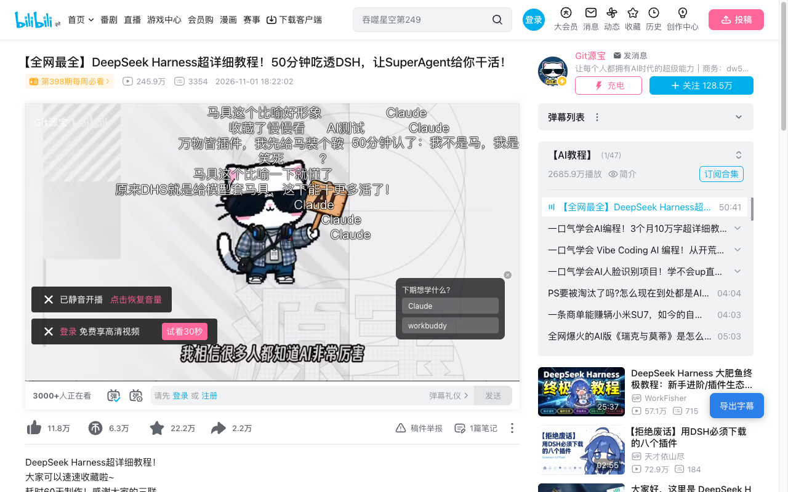

# 视频字幕导出

> 一键把 YouTube / 哔哩哔哩 的视频字幕导出为 `txt` 文件，**文件名就是视频标题**。

一个纯前端的 Chrome 扩展（Manifest V3），零后端、零依赖、零构建。所有处理都在浏览器本地完成，不上传任何数据。



---

## 特性

- **一键导出** —— 视频页右下角出现「导出字幕」按钮，点击即导出
- **文件名即视频标题** —— 无需手动改名，整理素材时特别省事
- **自动选择字幕来源** —— 优先上传者字幕，没有则用平台生成的 AI 字幕
- **文本自动整理** —— 去时间轴、修复滚动重复、按语义间隔重新分段，导出即可读
- **可选元信息头** —— 标题 / 链接 / 作者 / 时长 / 字幕来源 / 导出时间
- **隐私友好** —— 无服务器、无统计、无远程配置，字幕只存在于内存

## 安装

### 方式一：开发者模式加载（推荐）

```bash
git clone https://github.com/yrx00go/video-subtitle-exporter.git
```

1. 打开 `chrome://extensions`
2. 右上角开启「开发者模式」
3. 点击「加载已解压的扩展程序」
4. 选择仓库里的 `extension/` 目录

### 方式二：安装打包版本

下载 [Release](https://github.com/yrx00go/video-subtitle-exporter/releases) 里的 `.zip`，
解压后用同样的方式加载。

> 需要 Chrome 111+（依赖 `content_scripts.world: "MAIN"`）

## 使用

1. 打开任意 YouTube 或哔哩哔哩视频页
2. 等视频开始播放、字幕出现在画面上
3. 点右下角「导出字幕」
4. 下载目录里出现 `<视频标题>.txt`

也可以点浏览器工具栏的扩展图标，在弹出面板里操作。

### 前提条件

- **需要在浏览器里登录对应平台**。部分字幕（尤其是平台的 AI 字幕）未登录时不返回
- 仅能导出**平台已提供字幕数据**的视频

## 工作原理

### 核心难点

字幕不是「抓个接口」那么简单，两个平台都有各自的限制：

| 平台 | 限制 |
|---|---|
| YouTube | `timedtext` 接口有 pot 校验，对数据中心 IP 静默返回空；部分视频的字幕轨不在 `getPlayerResponse()` 里 |
| 哔哩哔哩 | 匿名不返回字幕轨；字幕 CDN 的 `auth_key` 分钟级过期；跨域带 credentials 会触发 CORS 拒绝 |

### 五级降级链路

```
① 页内嗅探缓冲区    播放器成功请求过的数据       最快最可靠
② 嗅探到的 player 轨 从 youtubei/v1/player 提取
③ playerResponse    页面常规路径
④ 转录稿接口         youtubei/v1/get_transcript  独立数据源
⑤ 扩展权限下载       service worker 绕开页面 CORS
   现场嗅探          自动点开 CC 触发播放器重新请求
```

### 两个关键设计

**1. 嗅探器必须在 `document_start` 以 `world: "MAIN"` 注入**

```json
{
  "js": ["content/sniffer-main.js"],
  "run_at": "document_start",
  "world": "MAIN"
}
```

用 `chrome.scripting.executeScript` 注入会有 background ↔ content script 的异步往返（几十毫秒），
**正好错过页面加载早期的关键请求**。由 manifest 声明式注入才能抢在播放器之前 hook `fetch` / `XHR`。

**2. 抓取代码跑在页面上下文，而不是 service worker**

- 页面上下文发起请求时，Cookie / Referer / UA 天然正确，反爬通过率最高
- 字幕 URL 带有时效签名，在页面内请求最「像人」
- 跨域下载失败时再回落到 service worker（有 `host_permissions`，不受页面 CORS 限制）

## 项目结构

```
extension/
├── manifest.json
├── background.js              # 调度：五级降级、下载、组装
├── content/
│   ├── sniffer-main.js        # MAIN world 嗅探器（document_start）
│   └── main.js                # 按钮注入 + 消息中转
├── lib/
│   ├── grabbers.js            # 平台抓取（注入 MAIN world，自包含）
│   ├── parser.js              # json3 / srv3 / 旧版 XML / b站 body 解析
│   ├── postprocess.js         # 去重、合并、断句
│   ├── filename.js            # 文件名清洗（非法字符、保留名、字节截断）
│   └── template.js            # txt 组装
├── popup.html / popup.js
└── icons/
```

## 开发与测试

```bash
npm install          # 仅测试需要 playwright-core

node --test test/unit.mjs        # 单元测试（18 项）
node test/mock-e2e.mjs youtube   # Mock 端到端：拦截接口返回真实格式数据
node test/mock-e2e.mjs bilibili
node test/popup-e2e.mjs          # 验证 popup → content → background 链路
node test/fallback-e2e.mjs       # 验证 CORS 兜底下载链路
```

测试用 Playwright 驱动真实 Chrome 加载扩展。注意：Chrome 137+ 移除了 `--load-extension`，
需要用 Chrome for Testing 或 Chromium。

详细测试记录见 [TEST-REPORT.md](TEST-REPORT.md)，方案设计见 [PLAN.md](PLAN.md)。

## 已知限制

| 限制 | 说明 |
|---|---|
| **硬字幕不支持** | 字幕若已烧录进视频画面（像素的一部分），没有任何文本数据可提取，只能靠 OCR |
| 需要登录 | 平台的 AI 字幕通常要求登录态 |
| 数据中心 IP 受限 | YouTube 对机房 IP 的字幕接口静默返回空 |
| 多分 P | 当前只导出当前 P，未做批量合并 |
| 播放列表 | 未实现批量导入 |

## 免责声明

本项目仅供**个人学习、研究与无障碍阅读**使用。

- 导出的字幕版权归原视频作者与平台所有
- 请勿用于二次分发、商业用途或任何侵犯版权的方式
- 使用本项目即表示你同意遵守各平台的服务条款

## License

[MIT](LICENSE)
